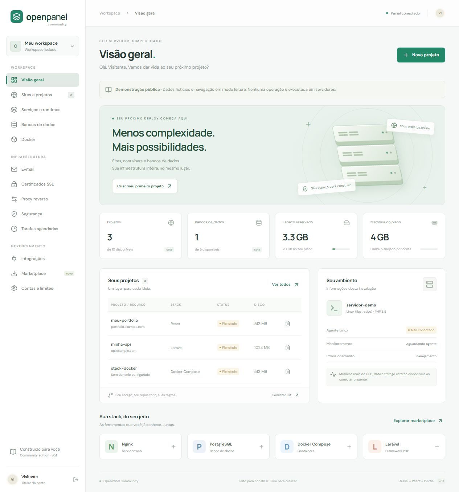

# qopenpanel-community

**Painel gratuito e open source para organizar a hospedagem de aplicações Linux.** Laravel 13 + React + Inertia, com licença MIT.

[Demo interativa](https://qualquer-de-tudo.github.io/qopenpanel-community/) · [Instalar em uma VPS](docs/INSTALL.md) · [AWS, Azure e outros provedores](docs/PROVIDERS.md) · [Contribuir](CONTRIBUTING.md) · [MCP para IAs](docs/MCP.md)

> **Versão 0.1 — MVP de planejamento.** Login, contas isoladas, cotas e cadastro de configurações funcionam. Instalação de serviços, deploys, SSL dos sites, e-mail, WAF e limites reais de hardware ainda dependem do futuro agente Linux. Consulte [o escopo](docs/STATUS.md).



## Demonstração gratuita

A demo usa a mesma interface React, com dados fictícios e operações de gravação bloqueadas. Pode ser publicada gratuitamente no GitHub Pages por meio do workflow incluído. Nenhum acesso administrativo, segredo ou servidor é exposto na demo. [Como publicar](docs/PUBLISHING.md).

## Instalação rápida

Em um servidor Linux com Git, Docker Engine e Compose 2.24.4 ou superior:

```bash
git clone https://github.com/qualquer-de-tudo/qopenpanel-community.git
cd qopenpanel-community
docker compose up -d --build
```

Abra localmente `http://127.0.0.1:8080`. Para acessar sua VPS, execute no seu computador:

```bash
ssh -L 8080:127.0.0.1:8080 usuario@IP_DO_SERVIDOR
```

Crie sua conta pelo túnel antes de publicar o domínio. Não há senha padrão. Para domínio e HTTPS automático, siga [o guia de instalação](docs/INSTALL.md). O painel utiliza PHP-FPM e Caddy; a porta FastCGI não é publicada.

## O que já funciona

- Dashboard responsivo, catálogo pesquisável e navegação via React/Inertia.
- Autenticação, proteção CSRF, limitação de tentativas e encerramento do setup após a primeira conta.
- Workspaces isolados por usuário, com validação de cotas de projetos, bancos e reservas de disco.
- Configurações planejadas para sites, Docker Compose, bancos, runtimes, e-mail, SSL, proxy, segurança, cron e integrações.
- Contas adicionais via `php artisan panel:account`, com senha solicitada no terminal.
- Imagens Docker, persistência de dados e workflow de testes/build.

## MCP para IAs

O endpoint MCP permite descoberta, gestão de configurações, cofre de credenciais por referências opacas, snapshots e restauração de configurações, planos de deploy e um broker de versionamento GitHub. Concessões têm escopos, validade e revogação; o modelo não recebe os valores do cofre. Consulte [conexão, comandos e limites de segurança](docs/MCP.md). A demo estática não oferece acesso MCP.

## Provedores

O mesmo Compose pode ser utilizado em máquinas Linux com Docker na AWS EC2/Lightsail, Azure Virtual Machines, DigitalOcean Droplets, Google Compute Engine, Hetzner, OVHcloud, Vultr, Linode/Akamai, Oracle Cloud e servidores próprios. O [guia por provedor](docs/PROVIDERS.md) explica rede e acesso. Apenas a instalação em Docker Linux local foi validada; não há certificação de deploy em cada nuvem.

O software não cobra licença. VPS, domínio, armazenamento, tráfego e serviços externos são cobrados conforme o provedor. Não prometemos infraestrutura gratuita.

## Desenvolvimento

Requer PHP 8.3+, Composer, Node 24 e extensão SQLite.

```bash
composer install
cp .env.example .env
php artisan key:generate
php -r "file_exists('database/database.sqlite') || touch('database/database.sqlite');"
php artisan migrate
npm ci
npm run build
php artisan serve
```

Para hot reload, execute `npm run dev` em outro terminal. Para construir e visualizar a demo: `npm run build:demo` e `npm run preview:demo`.

```bash
php artisan test
npm run build
npm run build:demo
```

## Licença e projeto

[MIT](LICENSE): uso, modificação e redistribuição permitidos nos termos da licença. Este é um projeto comunitário independente, sem afiliação com aaPanel ou outros projetos de nome semelhante. Dependências mantêm suas próprias licenças.
